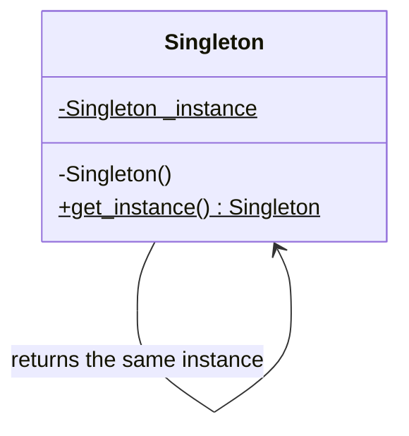
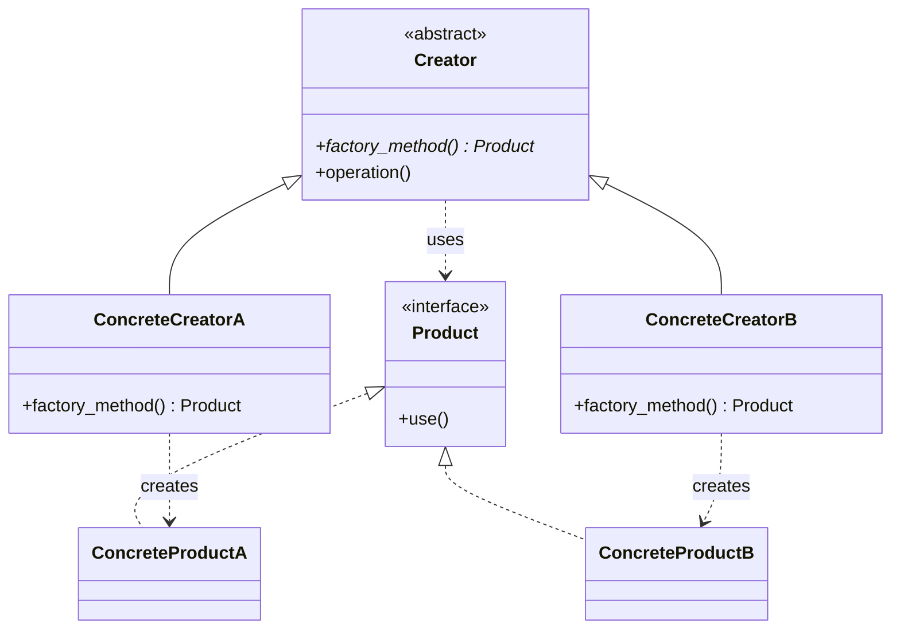
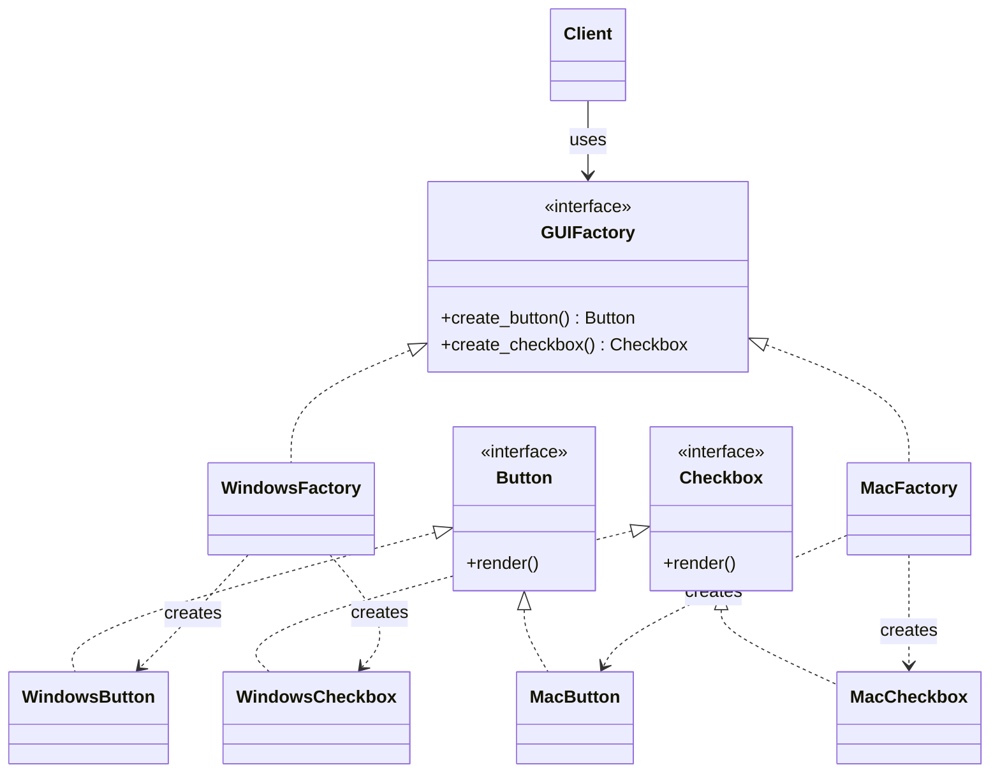
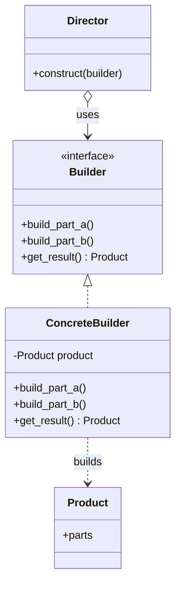
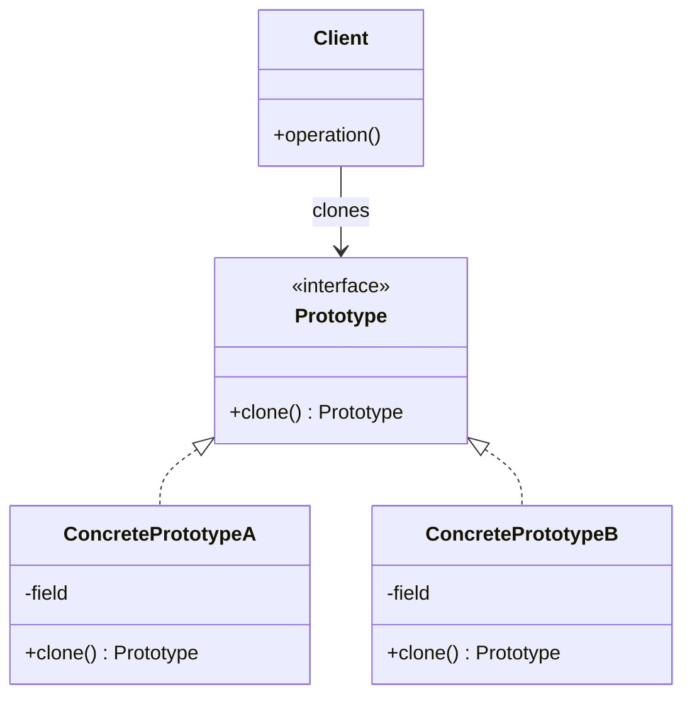

# Design Patterns in Python

Python implementations of all **23 Gang of Four (GoF) design patterns**, one file per pattern. Design patterns are reusable solutions to problems that come up again and again when designing object-oriented software. Knowing them helps you write code that is flexible and easy to extend, and gives you a shared vocabulary for system design and low-level design (LLD) discussions.

All code is in the [`Design Patterns`](./Design%20Patterns) folder.

## The three categories

| Category | Question it answers | Patterns |
|----------|---------------------|----------|
| **Creational** | How do I create objects flexibly? | 5 |
| **Structural** | How do I combine objects into larger structures? | 7 |
| **Behavioral** | How do objects communicate and share responsibility? | 11 |

## Quick chooser

| If you need to... | Use |
|-------------------|-----|
| Make sure only one instance exists | Singleton |
| Let subclasses decide which class to create | Factory Method |
| Build a complex object step by step | Builder |
| Copy an existing object instead of building a new one | Prototype |
| Make two incompatible interfaces work together | Adapter |
| Add features to an object without subclassing | Decorator |
| Hide a complicated subsystem behind a simple interface | Facade |
| Control access to an object (lazy load, cache, auth) | Proxy |
| Notify many objects when something changes | Observer |
| Swap algorithms at runtime | Strategy |
| Change behaviour based on internal state | State |
| Undo and redo actions | Command or Memento |
| Pass a request through a series of handlers | Chain of Responsibility |

---

## Creational patterns

These deal with **object creation**, hiding how objects are made so the rest of the code doesn't depend on concrete classes.

| Pattern | What it does | Real-world analogy | Use it when | File |
|---------|--------------|--------------------|-------------|------|
| **Singleton** | Ensures a class has exactly one instance with a global access point | One government per country | A shared logger, config, or connection pool | [`creational_1_singleton`](./Design%20Patterns/creational_1_singleton_designpattern.py) |
| **Factory Method** | A method creates objects, and subclasses choose which class to create | A logistics company deciding truck, ship, or plane per route | The exact type isn't known until runtime (email vs SMS sender) | [`creational_2_factorymethody`](./Design%20Patterns/creational_2_factorymethody_designpattern.py) |
| **Abstract Factory**  | Creates whole families of related objects without naming concrete classes | A furniture shop selling matching modern or vintage sets | UI themes, or one set of components per cloud provider | [`creational_3_adapterfactorymethod`](./Design%20Patterns/creational_3_adapterfactorymethod_designpattern.py) |
| **Builder** | Constructs a complex object step by step | Ordering a custom burger layer by layer | Objects with many optional parts (query builders, reports) | [`creational_4_builder`](./Design%20Patterns/creational_4_builder_designpattern.py) |
| **Prototype** | Creates new objects by cloning an existing one | Photocopying a filled form | Creating objects is expensive, or you need near-copies | [`creational_5_prototype`](./Design%20Patterns/creational_5_prototype_designpattern.py) |

## Structural patterns

These deal with **how classes and objects fit together** into larger structures.

| Pattern | What it does | Real-world analogy | Use it when | File |
|---------|--------------|--------------------|-------------|------|
| **Adapter** | Converts one interface into another that clients expect | A travel plug adapter | Integrating a third-party library or legacy code | [`structural_1_adapter`](./Design%20Patterns/structural_1_adapter_designpattern.py) |
| **Bridge** | Separates an abstraction from its implementation so both can vary | A remote control that works with any TV brand | Avoiding a class explosion (shapes × colours, devices × remotes) | [`structural_2_bridge`](./Design%20Patterns/structural_2_bridge_designpattern.py) |
| **Composite** | Treats single objects and groups of objects the same way | Folders containing files and other folders | Tree structures (file systems, menus, org charts) | [`structural_3_composite`](./Design%20Patterns/structural_3_composite_designpattern.py) |
| **Decorator** | Adds behaviour to an object dynamically by wrapping it | Adding toppings to a coffee | Extra features without subclassing (logging, caching, compression) | [`structural_4_decorator`](./Design%20Patterns/structural_4_decorator_designpattern.py) |
| **Flyweight** | Shares common data between many objects to save memory | Each letter in a text editor sharing one font object | A huge number of similar objects (characters, map tiles) | [`structural_5_flyweight`](./Design%20Patterns/structural_5_flyweight_designpattern.py) |
| **Facade** | Provides one simple interface to a complex subsystem | A hotel concierge handling many services | Simplifying use of a complicated library or set of services | [`structural_6_facade`](./Design%20Patterns/structural_6_facade_designpattern.py) |
| **Proxy** | A stand-in that controls access to another object | A credit card standing in for cash | Lazy loading, caching, access control, logging | [`structural_7_proxypattern`](./Design%20Patterns/structural_7_proxypattern_designpattern.py) |

## Behavioral patterns

These deal with **how objects interact** and how responsibilities are assigned.

| # | Pattern | What it does | Real-world analogy | Use it when |
|---|---------|--------------|--------------------|-------------|
| 1 | [**Observer**](./Design%20Patterns/1_observer_behavioral_designpattern.py) | Notifies many subscribers automatically when an object changes | Subscribers getting a new YouTube video alert | Event systems, notifications, live updates |
| 2 | [**State**](./Design%20Patterns/2_state_behavioral_designpattern.py) | An object changes behaviour when its internal state changes | A traffic light, or an order moving from placed to shipped | Many `if/else` branches on a status field |
| 3 | [**Strategy**](./Design%20Patterns/3_strategy_behavioral_designpattern.py) | Makes algorithms interchangeable at runtime | Choosing walking, bike, or car for a route | Multiple ways to do one task (payment methods, pricing rules) |
| 4 | [**Command**](./Design%20Patterns/4_command_behavioral_designpattern.py) | Wraps a request as an object so it can be queued, logged, or undone | A restaurant order slip | Undo and redo, task queues, macros |
| 5 | [**Chain of Responsibility**](./Design%20Patterns/5_chainOfResponsisbility_behavioral_designpattern.py) | Passes a request along handlers until one handles it | Customer support escalating from L1 to L2 to manager | Middleware, validation pipelines, approvals |
| 6 | [**Template Method**](./Design%20Patterns/6_template_method_behavioral_designpattern.py) | Defines an algorithm's skeleton and lets subclasses fill in steps | A recipe where only some steps change | Same workflow with variable steps (data import pipelines) |
| 7 | [**Interpreter**](./Design%20Patterns/7_interpreter_behavioral_designpattern.py) | Defines a grammar and evaluates sentences in it | Translating a language phrase by phrase | Expression evaluators, simple query languages |
| 8 | [**Visitor**](./Design%20Patterns/8_visitor_behavioral_designpattern.py) | Adds new operations to classes without changing them | A tax inspector visiting different kinds of buildings | Many operations over a stable set of classes |
| 9 | [**Memento**](./Design%20Patterns/9_memento_behavioral_designpattern.py) | Saves and restores an object's state without exposing its internals | A save point in a game | Undo, snapshots, checkpoints |
| 10 | [**Mediator**](./Design%20Patterns/10_mediator_behavioral_designpattern.py) | A central object coordinates communication between others | An air traffic controller | Reducing tangled many-to-many dependencies (chat rooms, UI forms) |
| 11 | [**Iterator**](./Design%20Patterns/11_iterator_behavioral_designpattern.py) | Gives sequential access to a collection without exposing its structure | Flipping through a book page by page | Custom collections (Python's `__iter__` and `__next__`) |

---

## Short examples

Simplified illustrations of three common patterns.

**Singleton**

```python
class Logger:
    _instance = None

    def __new__(cls):
        if cls._instance is None:
            cls._instance = super().__new__(cls)
        return cls._instance

assert Logger() is Logger()      # always the same object
```

**Strategy**

```python
def pay_by_card(amount): print(f"Paid {amount} by card")
def pay_by_upi(amount):  print(f"Paid {amount} by UPI")

class Checkout:
    def __init__(self, strategy):
        self.strategy = strategy

    def pay(self, amount):
        self.strategy(amount)

Checkout(pay_by_upi).pay(500)    # swap the strategy without changing Checkout
```

**Observer**

```python
class Subject:
    def __init__(self):
        self._observers = []

    def subscribe(self, fn):
        self._observers.append(fn)

    def notify(self, event):
        for fn in self._observers:
            fn(event)

news = Subject()
news.subscribe(lambda e: print("Email:", e))
news.subscribe(lambda e: print("SMS:", e))
news.notify("New post published")
```
---
## UML Diagrams:
GitHub renders Mermaid diagrams natively, so each of these can go straight into your README as a code block. Since you prefer things in manageable pieces, I'll do it in three parts: **creational (5)** now, then structural (7) and behavioral (11).

These are the textbook structure of each pattern, with generic class names, because I haven't seen your code. If you paste a file, I'll rename the boxes to match your classes.

## Creational patterns

### Singleton

One class holds its only instance and hands it out to everyone.



### Factory Method

The creator defers the choice of product to its subclasses.



### Abstract Factory 

Each factory produces a whole matching family of products. I used the UI-theme example (Windows and Mac).



> ⚠️ This assumes your `creational_3` file is Abstract Factory. If it's something else, tell me what it does and I'll redraw it.

### Builder

A director drives a builder through the steps, and the builder assembles the product.



### Prototype

Objects know how to clone themselves, so the client copies an existing one instead of building from scratch.



## How to read these

| Arrow | Meaning |
|-------|---------|
| `<|--` (solid, hollow triangle) | Inheritance ("is a") |
| `<|..` (dashed, hollow triangle) | Implements an interface |
| `..>` (dashed arrow) | Depends on or creates |
| `-->` (solid arrow) | Association (holds a reference) |
| `o-->` | Aggregation (has a, but the part can exist alone) |


---
## Guiding principles

- **Program to an interface, not an implementation**
- **Favour composition over inheritance**
- **Open for extension, closed for modification:** add behaviour by adding code, not editing working code
- **Don't force a pattern:** use one when it removes a real problem, not just because it exists

## Getting started

```bash
git clone https://github.com/SyedaNaziaGit/System-design-basic-design-patterns.git
cd "System-design-basic-design-patterns/Design Patterns"
python creational_1_singleton_designpattern.py
```

Replace the file name to run any other pattern. Python 3.8 or higher is enough, and there are no external dependencies.

## Project structure

```
System-design-basic-design-patterns/
├── Design Patterns/
│   ├── creational_1_singleton_designpattern.py
│   ├── creational_2_factorymethody_designpattern.py
│   ├── ...
│   ├── structural_1_adapter_designpattern.py
│   ├── ...
│   ├── 1_observer_behavioral_designpattern.py
│   └── ...
└── README.md
```

## Related projects

Patterns show up in real designs. See my [Low-Level System Design Case Studies](https://github.com/SyedaNaziaGit/Low-Level-System-Design-Case-Studies) (ATM, ride sharing, parking lot) for places where State, Strategy, and Factory fit naturally. 

## Author

**Syeda Nazia** · [GitHub](https://github.com/SyedaNaziaGit) · [LinkedIn](https://www.linkedin.com/in/syeda-nazia) · [Portfolio](https://syedanaziagit.github.io/nazia_portfolio_website/)
